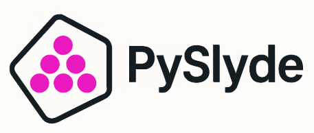

[](https://www.python.org/downloads/)
[](https://opensource.org/licenses/MIT)
[](https://badge.fury.io/py/pyslyde)
[](https://pyslyde.readthedocs.io/en/latest/)

PySlyde is a comprehensive Python package for preprocessing pathology whole slide images (WSIs). Built as a wrapper around [OpenSlide](https://openslide.org/), it provides powerful, user-friendly functionality for working with high-resolution pathology images, making it ideal for researchers and data scientists in the medical imaging domain. 

## Features

- **WSI Handling**: Supports large pathology slides and other WSI formats via OpenSlide
- **Efficient Preprocessing**: Streamline tasks like cropping, resizing, and filtering at high performance
- **Annotation Support**: Easily integrate and visualize annotations from multiple formats ([QuPath](https://qupath.github.io/), [ImageJ](https://imagej.net/), [ASAP](https://computationalpathologygroup.github.io/ASAP/), JSON, CSV)
- **Tesselation**: Flexible tiling options for patch extraction, ideal for deep learning workflows
- **Image Metadata Extraction**: Retrieve and manage metadata from WSIs
- **Multiple Output Formats**: Save processed data to disk, [LMDB](https://www.symas.com/lmdb), or [RocksDB](https://rocksdb.org/) databases
- **Tissue Detection**: Automatic tissue region detection and masking
- **Feature Extraction**: Built-in support for extracting features from tiles using latest pathology foundation models

## Installation

### System requirements

PySlyde needs the OpenSlide C library. The simplest option, on any platform, is:

```bash
pip install openslide-bin
```

Alternatively, install it with your system package manager (`sudo apt-get install libopenslide0`
on Ubuntu/Debian, `brew install openslide` on macOS). See the
[installation guide](https://pyslyde.readthedocs.io/en/latest/installation.html) for details and
the optional extras.

### From PyPI

```bash
pip install pyslyde
```

### From Source

```bash
git clone https://github.com/PharosKCL/pyslyde.git
cd pyslyde
pip install -e .
```

## Quick Start

The example below runs as-is: it downloads a small, openly licensed example slide
(1.9 MB, [details](https://pyslyde.readthedocs.io/en/latest/example_data.html)) on first use.
Replace the paths with your own slide and annotations. Feature extraction needs the optional
deep-learning dependencies: `pip install "pyslyde[feature-extractor]"` (or `"pyslyde[all]"`).

```python
from pyslyde import Slide, WSIParser
from pyslyde.datasets import example_data_dir
from pyslyde.util.utilities import TissueDetect

data = example_data_dir()
slide_path = str(data / "wsi" / "CMU-1-Small-Region.svs")

# Slide + annotations (QuPath, ImageJ, ASAP, GeoJSON, CSV or custom JSON)
slide = Slide(
    slide_path,
    annotations_path=str(data / "annotations" / "example.geojson"),
    source="geojson",
)
mask = slide.generate_mask(size=(555, 742))  # annotation mask
region, region_mask = slide.generate_region(level=0, x=(600, 1600), y=(1200, 2200))

# Tissue detection
detector = TissueDetect(slide_path)
tissue_mask = detector.detect_tissue()
border = detector.border()

# Tiling and feature extraction
parser = WSIParser(slide=slide, tile_dim=256, border=slide.get_border(), level=0)
parser.tiler(stride=256)
parser.sample_tiles(n=8, seed=0)
for (x, y), features in parser.extract_features(model_name="resnet18"):
    print((x, y), features.shape)

parser.save_tiles(tile_path="output/tiles")
```

See the [Quick Start guide](https://pyslyde.readthedocs.io/en/latest/quickstart.html) and the
[tutorial notebooks](docs/examples/) for the complete workflow.

## Documentation

📖 **📚 [Documentation](https://pyslyde.readthedocs.io/en/latest/)**

The documentation includes:

- **Installation Guide**: Detailed installation instructions and troubleshooting
- **Quick Start Guide**: Get up and running quickly with basic examples
- **Example data**: The openly licensed slide and synthetic annotations used throughout
- **Tutorials**: Executable notebooks (also in [`docs/examples/`](docs/examples/))
- **API Reference**: Generated from the docstrings, one page per module
- **Running the tests / Contributing**: How to test and contribute

## Contributing

Contributions are welcome! Please feel free to submit a Pull Request. For major changes, please open an issue first to discuss what you would like to change.

### Development setup

Install PySlyde from source with the development and documentation extras:

```bash
git clone https://github.com/PharosKCL/pyslyde.git
cd pyslyde
pip install -e ".[all,dev,docs]"
```

Build the documentation locally, then open `docs/_build/html/index.html`:

```bash
sphinx-build -W --keep-going -b html docs docs/_build/html
```

See [CONTRIBUTING.md](CONTRIBUTING.md) for how to run the tests, lint and format the code.

### Pull requests

1. Fork the repository
2. Create a feature branch (`git checkout -b feature/amazing-feature`)
3. Commit your changes (`git commit -m 'Add some amazing feature'`)
4. Push to the branch (`git push origin feature/amazing-feature`)
5. Open a Pull Request

### Development Tools

The project uses several development tools:

- **Testing**: [pytest](https://docs.pytest.org/) (unit tests, integration tests on the example dataset, executed docs snippets and notebooks; see [Running the tests](https://pyslyde.readthedocs.io/en/latest/testing.html))
- **Code Quality**: [ruff](https://docs.astral.sh/ruff/) for linting and formatting, [mypy](https://mypy-lang.org/) for type checking
- **Documentation**: [Sphinx](https://www.sphinx-doc.org/) with the [Read the Docs theme](https://sphinx-rtd-theme.readthedocs.io/)
- **Pre-commit**: [pre-commit](https://pre-commit.com/) Git hooks for code quality

## License

This project is licensed under the MIT License - see the [LICENSE](LICENSE) file for details.

## Contact

- **Author**: Gregory Verghese
- **Email**: gregory.e.verghese@kcl.ac.uk
- **Project Link**: [https://github.com/PharosKCL/pyslyde](https://github.com/PharosKCL/pyslyde)
- **Documentation**: [Documentation](https://pyslyde.readthedocs.io/en/latest/)
## Citation

If you use PySlyde in your research, please cite:

```bibtex
@software{pyslyde2024,
  title={PySlyde: A Lightweight, Open-Source Toolkit for Pathology Preprocessing},
  authors={Gregory Verghese, Anthony Baptista, Chima Eke, Holly Rafique, Liz Ing-Simmons, Enrico Parisini, Mengyuan Li, Fathima Mohamed, Ananya Bhalla, Lucy Ryan, Michael Pitcher, Concetta Piazzese, James Graham, Dinis Calado, Christopher Banerji, Anita Grigoriadis},
  year={2024},
  url={https://github.com/PharosKCL/pyslyde}
}
```


